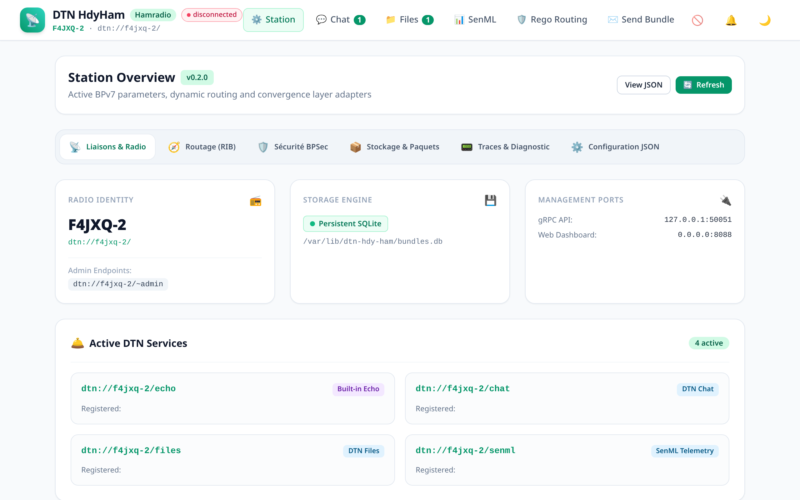
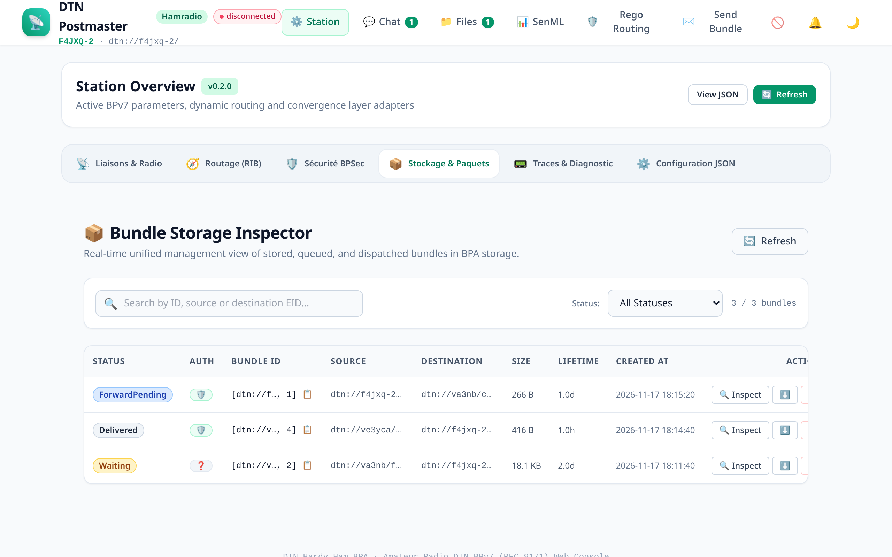
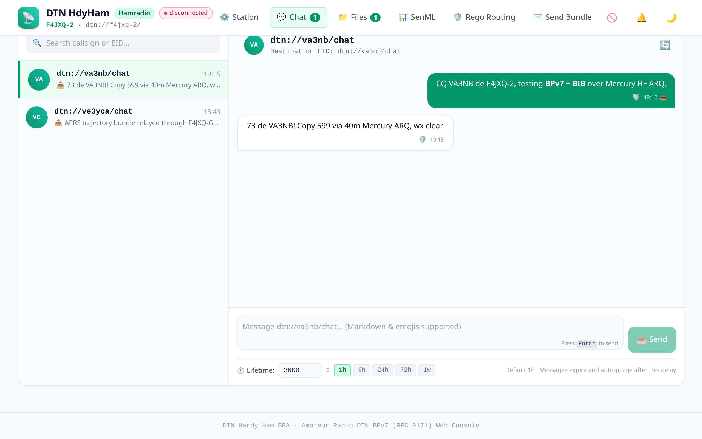
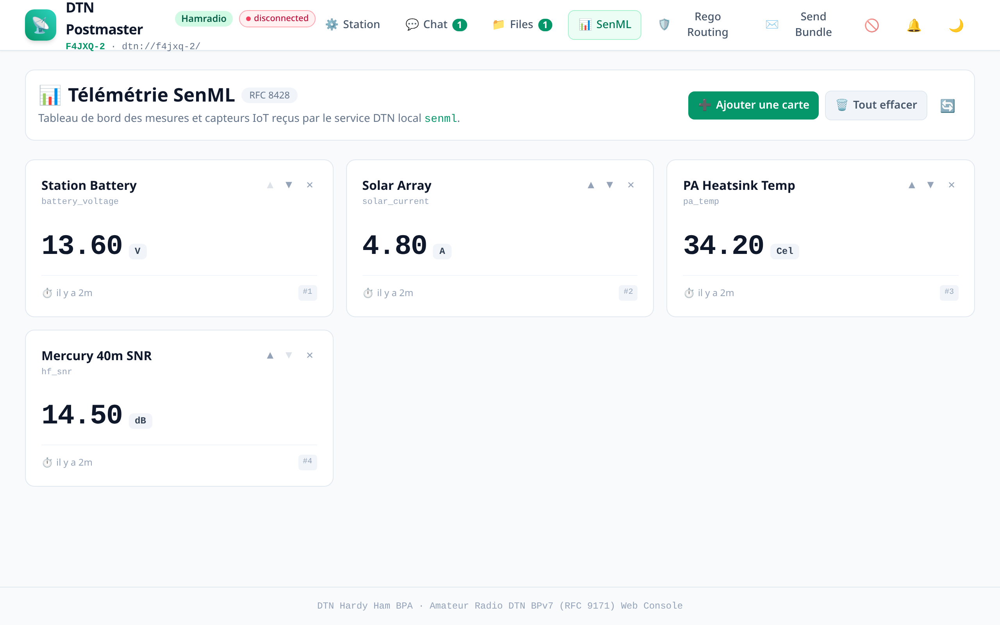
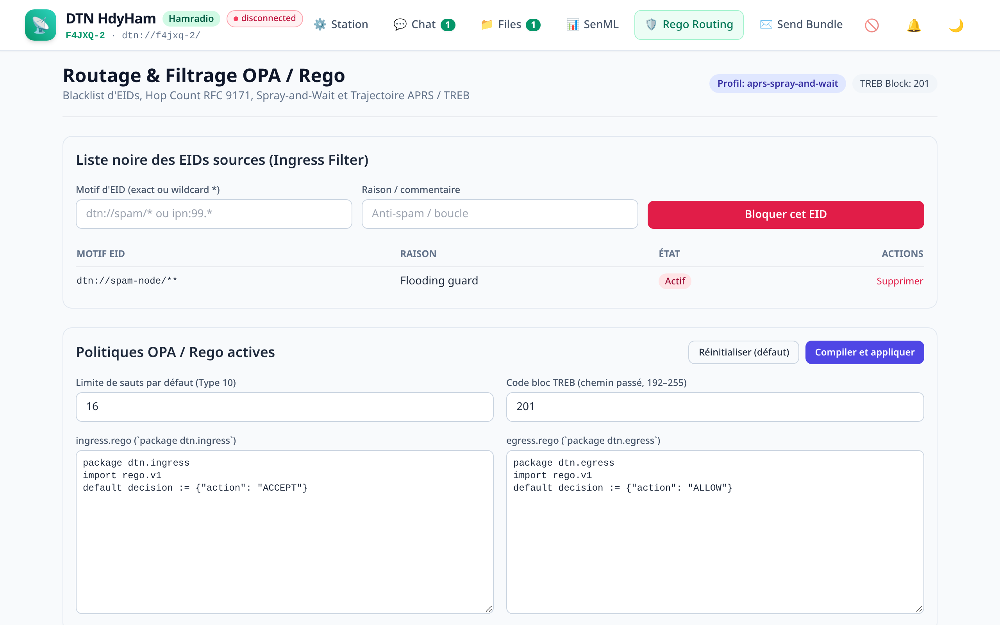
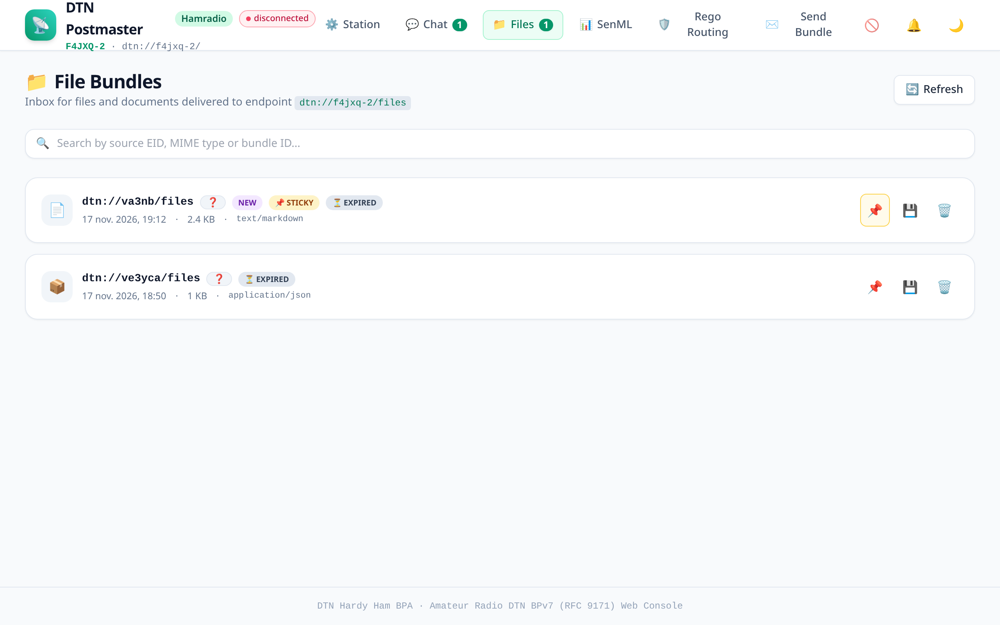

# dtnpm — DTN Postmaster

Modular assembly repository for **DTN Postmaster** (`dtnpm`), combining [`dtnpm-core`](../dtnpm-core), Convergence Layer Adapters, [`dtnpm-web-core`](../dtnpm-web-core), fullstack application modules, the `dtnpm` BPA daemon, and standalone DTN CLI utilities.

## Web Console Screenshots

| Station Overview | Bundle Storage Inspector |
| :---: | :---: |
|  |  |

| Interactive Chat | SenML Telemetry |
| :---: | :---: |
|  |  |

| Rego Routing & Filtering | File Bundles |
| :---: | :---: |
|  |  |

## Architecture & Component Repositories

| Crate | Purpose |
| --- | --- |
| [`dtnpm-core`](../dtnpm-core) | Configuration, SQLite storage, routing, CLA manager, BPsec keystore, `BpaClient` |
| [`dtnpm-cla-ltp-kiss`](../dtnpm-cla-ltp-kiss) | LTP (RFC 5326 / RFC 7122) engine & UDP/KISS CLA |
| [`dtnpm-cla-hqfbp-kiss`](../dtnpm-cla-hqfbp-kiss) | HQFBP over KISS TCP / Serial / UDP CLA |
| [`dtnpm-cla-mercury-arq`](../dtnpm-cla-mercury-arq) | Mercury HF Connected ARQ CLA |
| [`dtnpm-web-core`](../dtnpm-web-core) | Axum WebUI server, `WebModule` plugin trait, `/api/capabilities`, Preact shell |
| [`dtnpm-mod-chat`](../dtnpm-mod-chat) | Fullstack DTN Chat module (`/api/chat/v1/...`) |
| [`dtnpm-mod-files`](../dtnpm-mod-files) | Fullstack DTN File Transfer module (`/api/files/v1/...`) |
| [`dtnpm-mod-senml`](../dtnpm-mod-senml) | Fullstack DTN SenML RFC 8428 telemetry module (`/api/senml/v1/...`) |

## Cargo Feature Profiles

| Profile / Feature | Contents |
| --- | --- |
| `desktop` *(default)* | Full all-in-one station: `node`, `web-core`, `cla-ltp`, `cla-hqfbp`, `cla-mercury`, `mod-chat`, `mod-files`, `mod-senml` |
| `amsat` | Satellite / AMSAT station: `node`, `web-core`, `cla-ltp`, `cla-hqfbp`, `mod-senml` |
| `node-headless` | Headless RF/TCPCL router node with gRPC: `node`, `cla-ltp`, `cla-hqfbp`, `cla-mercury` |
| `webui-remote` | Remote operator console over gRPC: `web-core`, `mod-chat`, `mod-files`, `mod-senml` |
| `minimal` | Minimal station with BPA, CLI utilities, and Rego routing/WebUI: `node`, `cli`, `mod-rego-routing` |
| `cli` *(default)* | Enables `dtnpm` CLI entrypoint and the 11 utility binaries |
| `instrument` | Enables tracing spans (`tracing/attributes`, `hardy-bpa/instrument`) |

## Included Binaries (`cli` feature)

- `dtnpm`: Main BPA daemon and interactive configuration wizard
- `dtnbasket`, `dtnbasket-cli`: BPv7 Gemini/Web-over-DTN basket gateway and CLI
- `dtnbib`: Bundle-in-Bundle Encapsulation (BIBE) forwarder
- `dtnfiles`, `dtnforward`, `dtnping`, `dtnprint`, `dtnquery`, `dtnsend`, `dtntrigger`, `hdy-stats`

## Build, Test, and Profile Checks

Requires sibling checkouts (`../dtnpm-*`, `../../hardy/*`, `../../hqfbp-rs`).

```bash
# Run unit, binary, and integration tests with default features (desktop,cli)
cargo test --all-targets

# Verify deployment profiles
cargo check --no-default-features --features amsat
cargo check --no-default-features --features node-headless
cargo check --no-default-features --features webui-remote
cargo check --no-default-features --features minimal
cargo check --no-default-features --features "desktop,instrument"
cargo check --no-default-features --features "webui-remote,cli"
```

## Configuration & Documentation

- Example configurations: [config.example.yaml](config.example.yaml), [config.example.toml](config.example.toml), and [`examples/`](examples/)
- Architecture notes and ADRs: [`adr/`](adr/) and [`docs/`](docs/)
- Agent development guide: [`AGENTS.md`](AGENTS.md) and [`agent_docs/`](agent_docs/)
- Security policy & vulnerability reporting: [`SECURITY.md`](SECURITY.md)

## Security & Compliance Frameworks

- **Cyber Resilience Act (CRA)**: Secure-by-default posture, zero secret exposure in `/proc/<pid>/cmdline` (`--token-file`, `--password-stdin`), least-privilege systemd units with kernel/filesystem sandboxing, CycloneDX SBOM generation, and cryptographic SHA-1 40-char pinned CI workflows.
- **OWASP Top 10 / ASVS**: PBAC role-based access control, gRPC registration gate protecting against TOCTOU race conditions, strict host/CORS isolation, and safe process spawning (`kill_on_drop`, non-shell vector arguments).
- **BPSec (RFC 9172) & BPv7 (RFC 9171)**: Mandatory cryptographic signature verification by default under `VerifyPolicy::Strict`. Unauthenticated or degraded modes require explicit user opt-in flags (e.g. `--allow-unauthenticated-udp`, `--allow-unidentified-rf`, `--allow-third-party-report-to`).
- **Rust Quality Standards**: Zero-unwrap and zero-panic rule in production binaries and libraries (`-D clippy::unwrap_used -D clippy::panic`).

## License

Dual-licensed under the Apache License, Version 2.0 or the MIT License. See [LICENSE.md](LICENSE.md).
