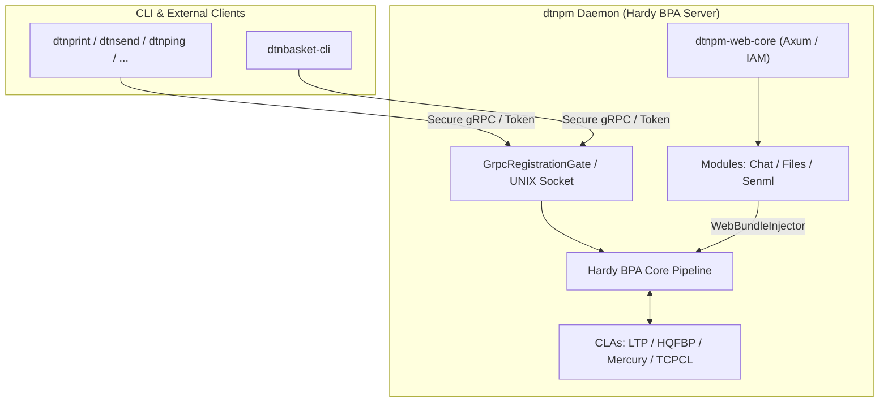

# System Architecture & Data Flows — `dtnpm`

This document details the modular architecture of `dtnpm`, its gRPC security gateway, and the data flows between the BPA daemon and satellite utilities.

---

## 1. Overview & Network Architecture

`dtnpm` interfaces with the `hardy` BPA engine through two complementary mechanisms:
1. **Secure gRPC Registration Gateway** (`GrpcRegistrationGate`):
   - Exposes a gRPC interface on a local port or via a dedicated UNIX socket (`/run/dtnpm/dtnpm.sock`).
   - Prevents TOCTOU race conditions by binding the socket immediately at startup and blocking unauthorized registrations until authentication and initialization are complete.
2. **Web Layer & Bundle Ingestion**:
   - `WebBundleInjector` registers an internal pseudo-CLA to inject bundles originating from WebModules (`mod-chat`, `mod-files`, `mod-senml`) directly into the BPA pipeline.

---

## 2. CLI Binaries & Engineering Specifics

### 1. Main Daemon (`dtnpm`)
- Embeds the `hardy` BPA, local PBAC authentication, the CLA manager, and the Web server.
- Manages the default configuration with Unix `0600` permissions via the `wizard` assistant.

### 2. Print Receiver (`dtnprint`)
- Registers as a service with the BPA.
- Receives raw CBOR bundles, verifies BPSec integrity (BIB), and atomically writes the payload to `stdout`.

### 3. Sender (`dtnsend`)
- Dynamically registers an ephemeral CLA with the BPA to inject bundles without source address restrictions.
- Supports BPSec signing (HMAC-SHA256 or Ed25519) and offline simulation mode (`-D / --dry-run`).

### 4. Storage Query Tool (`dtnquery`)
- Accesses SQLite (`metadata.db`) or PostgreSQL metadata directly offline.
- Uses queries with SQL pushdown (`LIKE ... ESCAPE` and `LIMIT`) to avoid loading all bundles into memory when filtering by address or computing global statistics.

### 5. Event Trigger (`dtntrigger`)
- Receives bundles on a dedicated endpoint, verifies the BPSec signature, writes the payload to a secure temporary file (`NamedTempFile`), and executes the configured command without passing through an uncontrolled shell interpreter.

### 6. Diagnostic Tool (`dtnping`)
- Sends timestamped DTN echo requests and calculates round-trip times (RTT).
- Bounds its tracking table to 10,000 entries to prevent memory leaks.

### 7. File Receiver (`dtnfiles`)
- Saves received files after a prior quota check, strict filename sanitization (128 alphanumeric characters and hyphens), and non-blocking asynchronous writing.

### 8. BIBE Encapsulator (`dtnforward` / `dtnbib`)
- Encapsulates incoming bundles into outer bundles (BIBE - RFC 5050 / RFC 9171).
- Accurately determines whether the destination is local by comparing node authorities (`NodeId`).

### 9. Metrics Collector (`hdy-stats`)
- Monitors daemon status via journald or log file reading.
- Restricts the report recipient authority (`report_to`) to the sending node unless explicitly authorized via `--allow-third-party-report-to`.
- Validates the journald unit name via a strict regular expression to prevent option injection.
