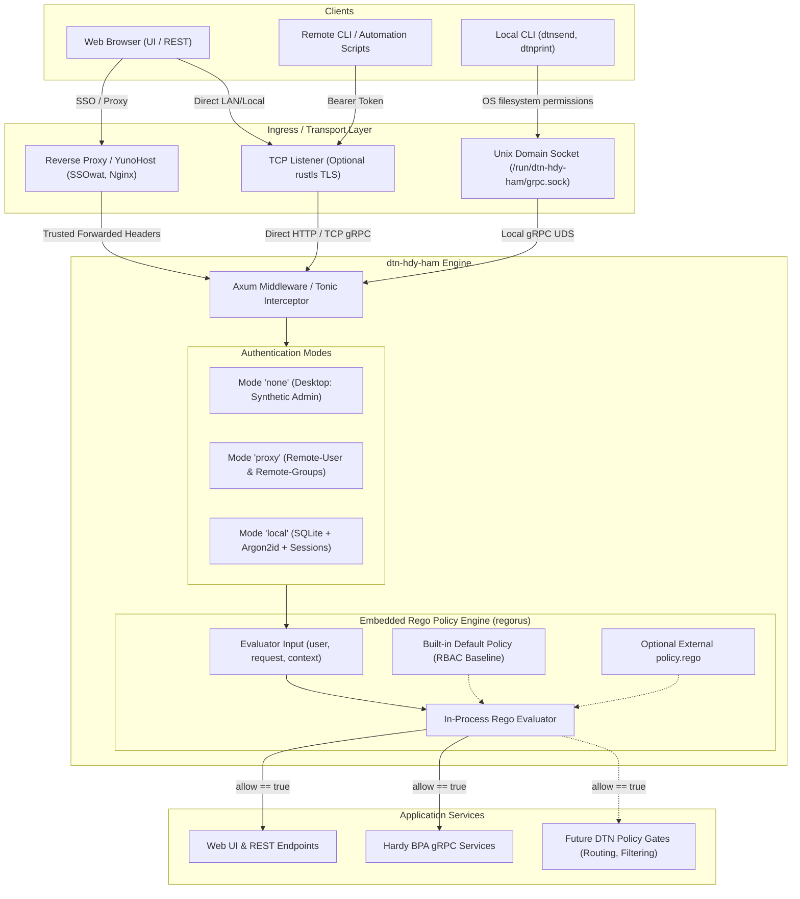

# Architecture & Workpackage Specification: PBAC (Rego/OPA) & Access Security for `dtn-hdy-ham`

This document defines the comprehensive strategy and technical workpackage for Identity, Authentication, and **Policy-Based Access Control (PBAC)** using an **embedded Rego engine** across all exposed interfaces of `dtn-hdy-ham` (Web UI, Axum REST API, gRPC endpoints, companion CLI utilities, and future DTN operational policies).

---

## 1. Vision & Core Objectives

### 1.1 Context and Drivers
`dtn-hdy-ham` serves as a dedicated BPv7 Bundle Processing Agent (BPA) and operational hub for amateur radio operators. It must resolve multiple deployment paradigms without compromising architectural agility:
1. **"Desktop / Local Shack Station"**: An amateur radio operator on a local shack PC (Linux, Windows, Raspberry Pi) wants to start the single binary and immediately operate without credentials to memorize, complex setup, or external daemons.
2. **"Self-Hosted / Radio-Club Server"**: In a shared club environment or home self-hosting stack (e.g., **YunoHost**, reverse-proxy setups using Nginx / Authelia / Caddy, or private VPNs like WireGuard / Tailscale), a single-station instance is shared between multiple operators and club officers.
3. **Policy-Based Access Control (PBAC) with Embedded Rego**: Rather than hardcoding static role checks (RBAC) in Rust code, access decisions are evaluated through declarative **Rego policies (Open Policy Agent)** executed by an **in-process embedded Rust Rego engine** (`regorus`).
4. **Unified Policy Engine for IAM & DTN**: Using Rego establishes a shared, flexible policy engine that can naturally expand beyond IAM to govern BPv7 routing, bundle filtering, transmission scheduling, and radio-band access rules.

### 1.2 Core Principles
* **Single Self-Contained Binary**: The Rego engine is embedded directly in the Rust application. No external OPA sidecar or Go runtime is required, preserving lightweight deployment on desktop and embedded Linux (e.g., Raspberry Pi).
* **Declarative RBAC-as-Policy Baseline**: A default embedded Rego policy implements standard `Admin` vs. `Operator` roles out of the box, requiring zero Rego authoring for standard users while enabling full customization for power users.
* **Strict Decoupling from BPv7 Protocols**: IAM authentication gates management and injection APIs without altering BPv7 bundle headers or EIDs (maintaining 100% RFC 9171 / RFC 9173 compliance).
* **Defense in Depth**: Policy evaluation runs in-application on all API and gRPC requests, complemented by reverse-proxy boundary verification.
* **Rust Production Quality**: 100% `unwrap`-free and `panic!`-free code, poison-safe state management, and constant-time comparisons (`subtle`).

---

## 2. Threat Model & Security Mitigations

| Threat / Attack Vector | Specific Scenario | Mitigation in `dtn-hdy-ham` |
| :--- | :--- | :--- |
| **Header Spoofing** | In `proxy` mode, an attacker bypasses the reverse proxy and sends forged headers (e.g. `Remote-User: admin`) directly to the application port. | Strict source IP validation: headers are only trusted if the immediate client IP matches `trusted_proxies` (or when binding exclusively to `127.0.0.1` / UDS). |
| **Web Brute-Force Attacks** | Repeated guessing of local passwords on `/api/v1/auth/login`. | Hardware-hardened hashing with `argon2id`, progressive delay / rate limiting on authentication routes. |
| **Session Hijacking & Leakage** | Eavesdropping or credential theft via cross-site scripting (XSS). | Opaque 256-bit CSPRNG session IDs delivered via `HttpOnly`, `SameSite=Lax` (or `Strict`), and `Secure` cookies. |
| **Privilege Escalation on CLI / gRPC** | Unauthorized local or remote execution of administrative gRPC calls. | Filesystem permission isolation for local UDS (`chmod 0660`, `dtn` group) and constant-time validated Bearer API tokens for remote TCP gRPC. |
| **Policy Execution Failure or Denial of Service** | Malformed or complex Rego rules causing unbounded latency. | In-process evaluation with execution timeouts; fallback to safe denial (`default allow = false`) on evaluation errors. |
| **Timing Attacks** | Inferring token or password hashes through response latency variations. | Constant-time comparisons across all token/password verification logic via `subtle::ConstantTimeEq`. |

---

## 3. High-Level Architecture



---

## 4. Policy-Based Access Control (PBAC) Design

### 4.1 Embedded Rego Engine Selection
`dtn-hdy-ham` integrates **`regorus`**, a pure-Rust implementation of Open Policy Agent (OPA) Rego:
* **Zero external dependencies**: Compiles directly into the Rust binary without requiring Go, CGO, or a separate OPA daemon.
* **In-memory evaluation**: Evaluations run in microseconds with zero network overhead.
* **Embeddable defaults**: The baseline policy is compiled into the binary via `include_str!("default_policy.rego")` with hot-reloadable overrides from disk when configured.

### 4.2 Rego Input Schema (`input`)

For every incoming HTTP request, REST call, or gRPC invocation, the middleware constructs a structured JSON `input` passed to the Rego evaluator:

```json
{
  "user": {
    "authenticated": true,
    "name": "f4kxl_admin",
    "roles": ["Admin"],
    "groups": ["admins", "radioclub_officers"],
    "auth_method": "proxy"
  },
  "request": {
    "interface": "web_api",
    "method": "POST",
    "path": "/api/v1/cla/tcpcl/restart",
    "action": "cla:manage",
    "client_ip": "127.0.0.1"
  },
  "context": {
    "station_callsign": "F4KXL",
    "timestamp": 1794500000,
    "auth_mode": "proxy"
  }
}
```

### 4.3 Default Embedded Rego Policy (`default_policy.rego`)

The default policy implements the baseline RBAC contract (Admin vs. Operator):

```rego
package dtn.ham.iam

default allow = false

# 1. Desktop mode ('none'): Everything is permitted for local operator
allow {
    input.context.auth_mode == "none"
}

# 2. Public / Unauthenticated endpoints (e.g. login, health, static web assets)
allow {
    input.request.path == "/api/v1/auth/login"
}
allow {
    input.request.path == "/api/v1/auth/me"
}
allow {
    startswith(input.request.path, "/static/")
}

# 3. Administrators have universal access
allow {
    input.user.authenticated == true
    "Admin" in input.user.roles
}

# 4. Operators have access to operational and observability endpoints
allow {
    input.user.authenticated == true
    "Operator" in input.user.roles
    is_operator_permitted_action
}

# Define what an Operator is allowed to do
is_operator_permitted_action {
    # Read-only inspection
    input.request.method in ["GET", "HEAD"]
}

is_operator_permitted_action {
    # Bundle & Chat submission
    input.request.method == "POST"
    input.request.path in [
        "/api/v1/bundles/inject",
        "/api/v1/chat/messages",
        "/api/v1/files/upload"
    ]
}
```

### 4.4 Advanced PBAC Capabilities Enabled by Rego

Because policies are written in Rego, station administrators can deploy custom rules without recompiling Rust:
* **Time-based restrictions**: Restrict certain amateur operators or automated scripts to specific hours (e.g. daytime operation).
* **Action-level permissions**: Allow specific users to restart only a particular CLA (e.g. Mercury TNC) without granting full station administrator rights.
* **DTN-Specific Extensions (Future Workpackages)**:
  * Restrict bundle injection by destination EID (e.g. `dtn://local-club/*` permitted, `dtn://emergency/*` restricted).
  * Rate-limit or size-limit bundle uploads per user (e.g. non-admins limited to bundles < 500 KB).

---

## 5. Technical Specifications

### 5.1 Configuration Schema (`config.toml` / `config.yaml`)

```toml
[auth]
# Authentication mode: "none", "proxy", or "local"
mode = "proxy"

# Users and groups granted default 'Admin' role in input document
admin_users = ["f4kxl_admin", "loic"]
admin_groups = ["admins", "radioclub_officers"]

# Optional external Rego policy file. If omitted, uses embedded default_policy.rego
policy_path = "/etc/dtn-hdy-ham/policy.rego"

# Session validity duration (for local mode)
session_ttl = "7d"

[auth.proxy]
# Trusted HTTP headers supplied by the upstream proxy
header_user = "Remote-User"
header_groups = "Remote-Groups"

# IP addresses or CIDR blocks of trusted reverse proxies
trusted_proxies = ["127.0.0.1/32", "::1/128"]

[grpc.auth]
# Enable access control on the gRPC listener
enabled = true

# Local Unix Domain Socket for zero-token local CLI interactions
socket_path = "/var/run/dtn-hdy-ham/grpc.sock"
socket_group = "dtn"
socket_mode = 0o660

# Static or dynamically managed tokens for remote TCP gRPC
tokens = [
    { token = "hdy_sec_9f823a...", role = "Admin", description = "Station Monitoring Daemon" }
]

[tls]
# Optional internal TLS termination (rustls)
enabled = false
cert_path = "/etc/ssl/certs/dtn-hdy-ham.crt"
key_path = "/etc/ssl/private/dtn-hdy-ham.key"
```

### 5.2 SQLite Data Model (`rusqlite`)

The internal storage maintains three IAM tables:

```sql
-- Local users table
CREATE TABLE IF NOT EXISTS iam_users (
    id INTEGER PRIMARY KEY AUTOINCREMENT,
    username TEXT NOT NULL UNIQUE COLLATE NOCASE,
    password_hash TEXT NOT NULL,
    role TEXT NOT NULL DEFAULT 'Operator',
    created_at INTEGER NOT NULL,
    updated_at INTEGER NOT NULL
);

-- Active Web sessions
CREATE TABLE IF NOT EXISTS iam_sessions (
    id TEXT PRIMARY KEY, -- 64-character hex opaque token
    user_id INTEGER NOT NULL REFERENCES iam_users(id) ON DELETE CASCADE,
    created_at INTEGER NOT NULL,
    expires_at INTEGER NOT NULL
);
CREATE INDEX IF NOT EXISTS idx_iam_sessions_expires ON iam_sessions(expires_at);

-- API tokens for remote CLI and automated tools
CREATE TABLE IF NOT EXISTS iam_api_tokens (
    id INTEGER PRIMARY KEY AUTOINCREMENT,
    name TEXT NOT NULL,
    token_hash TEXT NOT NULL UNIQUE, -- SHA-256 hash of the bearer token
    token_prefix TEXT NOT NULL,     -- e.g. "hdy_adm_..." for identification
    role TEXT NOT NULL DEFAULT 'Operator',
    created_at INTEGER NOT NULL,
    last_used_at INTEGER
);
```

### 5.3 Axum & Tonic Middleware Flow with PBAC

1. **Authentication Step**:
   * Mode `none`: Generates `AuthUser { name: "local-operator", roles: ["Admin"], method: None }`.
   * Mode `proxy`: Validates peer IP against `trusted_proxies`, extracts `Remote-User` and `Remote-Groups`. Assigns roles (`Admin` if listed in config, else `Operator`).
   * Mode `local`: Validates session cookie or Bearer token; queries SQLite store for username and role.
2. **Policy Evaluation Step**:
   * Middleware assembles the `input` JSON document.
   * Calls the thread-safe `PolicyEngine::evaluate("data.dtn.ham.iam.allow", &input)`.
   * If evaluation returns `true`, request proceeds.
   * If evaluation returns `false`, returns `403 Forbidden` (with structured JSON error).

### 5.4 Session Introspection Endpoint (`GET /api/v1/auth/me`)

Enables the Web UI frontend to discover identity and allowed capabilities:
```json
{
  "authenticated": true,
  "username": "f4kxl_admin",
  "roles": ["Admin"],
  "auth_mode": "proxy",
  "capabilities": {
    "can_manage_clas": true,
    "can_restart_server": true,
    "can_inject_bundles": true
  }
}
```

---

## 6. Workpackage Breakdown (Roadmap)

```
┌────────────────────────────────────────────────────────┐
│ WP1: Core Storage, Crypto & Regorus Policy Engine      │
│ • SQLite IAM schema migrations (users, sessions, tokens│
│ • Argon2id hashing & CSPRNG session token generator   │
│ • Embedded regorus engine + embedded default_policy    │
└──────────────────────────┬─────────────────────────────┘
                           │
┌──────────────────────────▼─────────────────────────────┐
│ WP2: Axum PBAC Middleware & "none" / "proxy" Modes     │
│ • Input document generator & policy evaluation layer   │
│ • trusted_proxies validation & header parsing          │
│ • Fallback handling (safe denial on policy failure)    │
│ • Introspection endpoint: GET /api/v1/auth/me          │
└──────────────────────────┬─────────────────────────────┘
                           │
┌──────────────────────────▼─────────────────────────────┐
│ WP3: "local" Mode & Web Session Management             │
│ • Endpoints: POST /api/v1/auth/login and logout        │
│ • HttpOnly cookie issuance & session lifecycle         │
│ • CLI account management: dtn-hdy-ham user ...         │
└──────────────────────────┬─────────────────────────────┘
                           │
┌──────────────────────────▼─────────────────────────────┐
│ WP4: gRPC Hardening & CLI Tooling                      │
│ • Unix Domain Socket (UDS) listener & permissions      │
│ • Tonic Bearer Token interceptor evaluated via Rego    │
│ • CLI flag --token / ENV DTN_HDY_TOKEN support         │
└──────────────────────────┬─────────────────────────────┘
                           │
┌──────────────────────────▼─────────────────────────────┐
│ WP5: Web UI Frontend Integration                       │
│ • Login view/modal for "local" mode                    │
│ • Dynamic UI section visibility based on /auth/me      │
│ • User status indicator & logout action                │
└──────────────────────────┬─────────────────────────────┘
                           │
┌──────────────────────────▼─────────────────────────────┐
│ WP6: Verification, Documentation & YunoHost Recipe     │
│ • Test suite (embedded Rego test suite + Axum tests)   │
│ • YunoHost Nginx SSOwat configuration template         │
│ • Security audit verification (check-security.sh)      │
└────────────────────────────────────────────────────────┘
```

### Detailed Task Descriptions

#### **WP1: Foundations — Storage, Crypto & Embedded Rego Engine**
* Integrate `regorus` into `dtn-hdy-ham/Cargo.toml`.
* Implement `PolicyEngine` wrapper: manages embedded `default_policy.rego`, optional external policy file loading, and thread-safe evaluation.
* Add SQLite schema migration steps in `internal_storage` for `iam_users`, `iam_sessions`, and `iam_api_tokens`.
* Integrate `argon2` and `subtle` crates; implement password hashing, verification, and CSPRNG token generation.
* Unit test policy evaluation for both Admin and Operator scenarios.

#### **WP2: Axum PBAC Middleware & `none` / `proxy` Modes**
* Implement Axum middleware constructing the Rego `input` document and invoking `PolicyEngine`.
* Verify client IP against `trusted_proxies` and extract `Remote-User` / `Remote-Groups`.
* Provide automatic `Admin` attribution under `mode = "none"`.
* Guard administrative REST endpoints (CLA configuration, service restart, route changes).
* Implement `GET /api/v1/auth/me`.

#### **WP3: `local` Mode & Account Management**
* Build session manager (token generation, SQLite persistence, automated expired session pruning).
* Implement `POST /api/v1/auth/login` and `POST /api/v1/auth/logout`.
* Implement CLI subcommands:
  * `dtn-hdy-ham user add <username> --role <admin|operator>`
  * `dtn-hdy-ham user passwd <username>`
  * `dtn-hdy-ham user list`
  * Integrate admin account creation into `dtn-hdy-ham init`.

#### **WP4: gRPC Hardening & CLI Integration**
* Implement UDS binding with POSIX permissions in `hardy-proto` / `dtn-hdy-ham`.
* Implement Tonic request interceptor validating Bearer tokens against configuration and SQLite tokens table.
* Evaluate gRPC actions through the same Rego engine (`action = "grpc:bundle:inject"`).
* Update CLI utilities (`dtnprint`, `dtnsend`, `dtnquery`) with `--token` parameter and `DTN_HDY_TOKEN` environment variable support.

#### **WP5: Frontend Web UI Integration**
* Implement clean login form for `local` mode.
* Query `/api/v1/auth/me` on initial SPA load.
* Dynamically hide administrative menus and controls (CLA configuration, radio frequency changes, BPSec key management) when disallowed by policy.
* Add user status indicator (username, role badge, logout button).

#### **WP6: Testing, Documentation & YunoHost Packaging**
* Implement end-to-end integration tests covering all three modes (`none`, valid/untrusted `proxy`, `local`).
* Write unit tests in Rego (`policy_test.rego`) validating policy logic directly.
* Create YunoHost deployment guide and sample Nginx configuration leveraging SSOwat headers.
* Ensure full compliance with repository standards:
  * 100% `unwrap`-free and `panic!`-free production code.
  * Successful run of `cargo test`, `cargo clippy`, `cargo fmt --check`, and `./scripts/check-security.sh`.

---

## 7. Acceptance Criteria

1. **Desktop Zero-Friction**: With default settings (`mode = "none"`), `dtn-hdy-ham` starts out of the box with zero credentials, and the embedded policy grants full access to the local operator.
2. **In-Process Rego Evaluation**: Policy evaluation runs embedded in memory via `regorus` without spawning any external process or network daemon.
3. **Policy Extensibility**: Placing a custom `policy.rego` on disk allows modifying access rules without recompiling the binary.
4. **Proxy Header Isolation**: Any HTTP request containing `Remote-User` coming from an IP not listed in `trusted_proxies` is rejected immediately.
5. **Strict PBAC Enforcement**: An `Operator` account can successfully inject bundles, browse files, and send chat messages, but receives `403 Forbidden` when attempting to modify CLA configurations or restart services under the default policy.
6. **Local CLI Continuity**: Local CLI tools connect seamlessly over the Unix Domain Socket without manual token entry.
7. **Quality & Security Pass**: All automated tests pass, zero panics, strict security checks verified.
